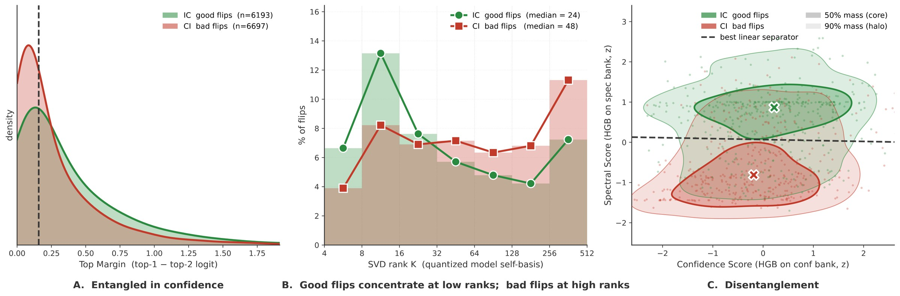
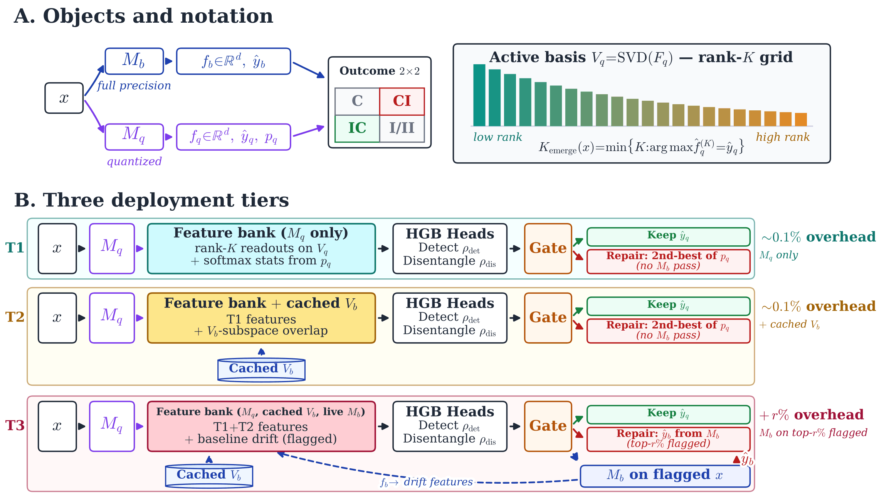
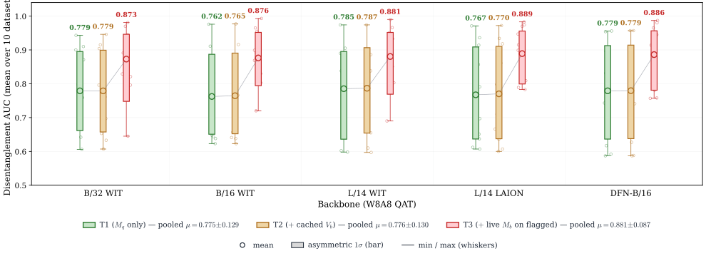
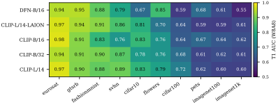

<div align="center">

# Disentangling the Good From the Bad:<br>Quantization-Induced Flips Are Not Random

**Aymen Bouguerra** · **Fabio Arnez** · **Alexandra Gomez-Villa** · **Chokri Mraidha**

Université Paris-Saclay, CEA-List

**NeurIPS 2026** · Poster

[](https://aymenbouguerra.github.io/Disentangling-the-Good-From-the-Bad-Quantization-Induced-Flips-Are-Not-Random/)
[](https://github.com/CEA-LIST/Disentangling-the-Good-From-the-Bad-Quantization-Induced-Flips-Are-Not-Random)
[](#-citation)



<sub><b>(A)</b> The quantized softmax margin used by prior work overlaps for good (IC) and bad (CI) flips.
<b>(B)</b> Along the SVD rank of the quantized model's own feature space, good flips emerge at low ranks and bad flips need the high-rank tail.
<b>(C)</b> A confidence score and a spectral score together largely disentangle the two populations (pooled CLIP-B/16, W8A8 QAT, 12,890 flips).</sub>

</div>

---

> **TL;DR:** A quantized model that matches its full-precision baseline in accuracy still changes 3–18% of its
> predictions. These flips are not rounding noise: good flips (incorrect → correct) and bad flips
> (correct → incorrect) live in different parts of the quantized model's SVD spectrum. A post-hoc gate that reads
> them can keep the good flips and repair the bad ones, recovering accuracy at a cost of microseconds per input.

## 🌐 Project page

**[aymenbouguerra.github.io/Disentangling-the-Good-From-the-Bad-Quantization-Induced-Flips-Are-Not-Random](https://aymenbouguerra.github.io/Disentangling-the-Good-From-the-Bad-Quantization-Induced-Flips-Are-Not-Random/)**

## 💻 Code

The reproduction code is available at
**[CEA-LIST/Disentangling-the-Good-From-the-Bad-Quantization-Induced-Flips-Are-Not-Random](https://github.com/CEA-LIST/Disentangling-the-Good-From-the-Bad-Quantization-Induced-Flips-Are-Not-Random)**.

## ✨ Highlights

- 🔬 **Flips are structured, not random:** good flips emerge at low SVD ranks of the quantized feature space
  (median rank 24), bad flips need the high-rank tail (median 48).
- 🧮 **Disentangled from the quantized model alone:** on 50 CLIP cells (5 backbones × 10 datasets, W8A8) the T1 gate
  reaches a mean Dis AUC of **0.760**, and **0.870** when the full-precision model is consulted on the flagged
  inputs (T3).
- 🎯 **Spectral, not confidence:** on the same cells and head, the spectral bank beats softmax confidence on every
  cell of the ablation (0.838 vs 0.626 mean Dis AUC) and the raw quantized features on 10 of 12.
- 📈 **Accuracy recovered:** on accuracy-matched CLIP-B/16 W8A8 QAT the T1 gate recovers **+0.73 pp** without running
  the full-precision model; on production PTQ (GPTQ, QuaRot / SpinQuant + GPTQ, SmoothQuant, AWQ, bitsandbytes)
  every recipe gains, up to **+5.27 pp**.
- ⚡ **Negligible cost:** the T1 / T2 gate adds about **0.03%** of a CLIP-B/16 forward in compute, with no second
  model in memory.

<details>
<summary><b>Abstract</b></summary>
<br>

Model quantization has advanced tremendously in recent years, producing models that require a fraction of the compute while maintaining baseline accuracy and creating the illusion of lossless compression. Beneath the surface, however, model behavior undergoes severe shifts that simple global accuracy fails to capture. Notably, quantized models experience a high rate of "flips": individual predictions that change from correct to incorrect (bad flips-CI) and vice versa (good flips-IC). Although overall accuracy remains stable, these changes degrade model reliability and introduce unforeseen safety risks. Current literature largely attributes these flips to random rounding noise, a perspective that ignores the specific precision constraints imposed by quantization with or without training.

In this paper, we show that flips are driven by quantization's implicit regularization, low-pass filtering, and exacerbated spectral bias. By analyzing these effects via Singular Value Decomposition (SVD), we leverage the model's low-to-high rank internal disagreement to disentangle good flips from bad ones. Building on this insight, we introduce a post-hoc gate, fitted once with labels on a calibration pool, that flags likely bad flips and repairs them while leaving good flips untouched: a standalone tier needs only the quantized model, and a selective tier additionally consults the full-precision model. We test the disentanglement from Post-Training Quantization (PTQ) to Quantization-Aware Training (QAT) across vision, language, and multi-modal models, with the densest evidence on 50 CLIP settings; the signal weakens as the number of classes grows. With this work, we aim not only to restore the quantized model's hidden reliability degradation but, on accuracy-matched settings and with the quantized model alone, to lift it above its full-precision counterpart.

</details>

## 🧭 Method

<p align="center"></p>

A feature bank built from the quantized model's own SVD basis (rank-*K* readouts, the rank at which each prediction
emerges, softmax statistics) feeds a single gradient-boosted head that scores how likely an input is a bad flip. The
top-*r*% inputs are repaired: **T1** and **T2** use the second-best class of the quantized model (T2 adds a cached
full-precision basis to the features), **T3** calls the full-precision model on the flagged inputs.

## 📊 Key results

<p align="center"></p>

On five CLIP backbones × ten datasets at matched-accuracy W8A8, T3 sits between 0.84 and 0.89 for every backbone,
and the ordering T1 < T2 ≤ T3 holds on every family tested (CLIP, generative VLMs, ViT, CNN, LLMs, VLA).

<p align="center"></p>

The quantized-model-only signal weakens as the number of classes grows; a full-precision pass on the flagged inputs
(T3) and tighter precision both recover it.

## 📝 Citation

If you find this work useful, please cite:

```bibtex
@inproceedings{bouguerra2026disentangling,
  title     = {Disentangling the Good From the Bad: Quantization-Induced Flips Are Not Random},
  author    = {Bouguerra, Aymen and Arnez, Fabio and Gomez-Villa, Alexandra and Mraidha, Chokri},
  booktitle = {Advances in Neural Information Processing Systems (NeurIPS)},
  year      = {2026}
}
```

This work builds on the spectral description of quantization introduced in our ICML 2026 paper
[*Less Precise Can Be More Reliable: A Systematic Evaluation of Quantization's Impact on VLMs Beyond
Accuracy*](https://proceedings.mlr.press/v306/bouguerra26a.html) (PMLR 306), by **Aymen Bouguerra**, Daniel Alfonso Montoya Vasquez, Alexandra Gomez-Villa,
Chokri Mraidha and Fabio Arnez.

```bibtex
@inproceedings{bouguerra26a,
  title     = {Less Precise Can Be More Reliable: A Systematic Evaluation
               of Quantization's Impact on {VLMs} Beyond Accuracy},
  author    = {Bouguerra, Aymen and Montoya Vasquez, Daniel Alfonso and Gomez-Villa, Alexandra
               and Mraidha, Chokri and Arnez, Fabio},
  booktitle = {Proceedings of the 43rd International Conference on Machine Learning},
  pages     = {9363--9391},
  year      = {2026},
  volume    = {306},
  series    = {Proceedings of Machine Learning Research},
  publisher = {PMLR},
  url       = {https://proceedings.mlr.press/v306/bouguerra26a.html}
}
```
